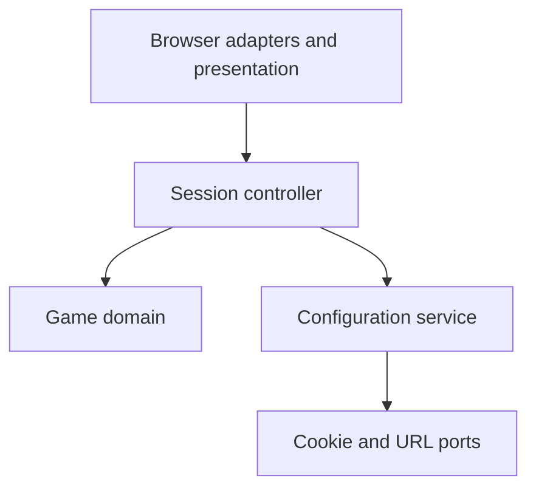

# Architecture

## Context and direction

The [project brief](PROJECT.md) defines a desktop keyboard Tetris game with penetrator gameplay and persistent settings. Use a static TypeScript application, Canvas for board rendering, and labelled HTML controls for settings and session actions. Production assets run without an application server or third-party runtime services.

## Major blocks

| Block | Responsibility and ownership | Dependencies |
| --- | --- | --- |
| Game domain | Authoritative board, active piece, queue, Hold, scoring, bonuses, landing rules, lifecycle and lock timing. Computes transitions and immutable view snapshots. | Internal geometry/rule functions and explicitly supplied elapsed time and random samples; no browser APIs. |
| Session controller | Creates and disposes a game session, translates input and elapsed time into ordered domain commands, applies resolved settings and schedules rendering. | Domain, configuration service, input, clock and view adapters. |
| Configuration service | Canonical setting schema, validation, source resolution and selected settings. Coordinates best-effort cookie/URL persistence. | Narrow cookie and URL ports; no board or scoring dependencies. |
| Browser presentation and adapters | Canvas drawing, DOM panels, keyboard/focus handling, monotonic clock, URL and cookie access. Owns browser resources and listener cleanup. | Read-only domain snapshots and controller actions; browser APIs. |

The controller composes the blocks. Presentation cannot mutate domain state, and domain transitions cannot read cookies, location, DOM or wall-clock time. The configuration service passes typed values to the controller rather than changing the active board. No event bus, dependency-injection framework or interchangeable game-engine hierarchy is needed.

## Relationships

The diagram shows invocation/dependency direction; snapshots return to the controller and presentation. Cookie and URL adapters implement the service's narrow ports at composition time. The domain never depends on configuration persistence or rendering.

## State and lifecycle

One domain state owns the settled board, active piece and mode, piece supply, Hold eligibility, score/level/lines, bonuses, game status, effective piece locking policy and grounded timer. A transition commits a lock, line clear, score update, bonus award and subsequent spawn atomically. No observer sees a partially merged piece or cleared board.

The configuration service owns the selected settings. The controller applies visibility and availability changes to the current session immediately and snapshots locking policies when spawning each piece. UI controls distinguish selected policy from an active piece's effective policy. Restart creates fresh domain state while preserving selected settings.

The controller serializes time advancement and commands. It advances game time to a command's timestamp before applying that command; an expired deadline therefore takes precedence over input arriving at that deadline. Pausing stops domain-time advancement and clears held-input repeat state. Resume establishes a fresh clock reference. Browser listeners, animation frames and held-input resources belong to one session and are released on disposal.

## Landing, traversal and locking

Geometry provides a single canonical landing calculation consumed by domain gravity/hard drop and the ghost view. Regular pieces stop at the first blocking row; penetrators select the lowest clear in-board placement at or below their current location despite intervening blockers. Distinguish temporary penetrator traversal overlap from a valid lock placement. Only the domain's validated lock operation writes settled cells.

Grounded timing belongs to domain state, so injected elapsed time can test it exactly. Rendering cadence and key-repeat timing never own the lock deadline. Piece transformations may cancel a timer only when support is lost; they cannot refresh a timer while support remains. Bonus spend and activation occur in one accepted transition, and Hold eligibility checks the active mode before any exchange.

## Configuration and failure boundaries

Validate each setting at the service boundary using its typed schema. Cookie and URL adapters return raw values or an unavailable result; the service resolves precedence without affecting other settings. Persistence attempts are independent and best-effort. Browser exceptions cannot prevent in-memory play or undo a selected setting. Preserve unrelated URL state.

The domain rejects invalid gameplay commands without partial state changes. A missing Canvas rendering context is a fatal presentation startup failure shown in the DOM; unavailable persistence is recoverable and shown as a concise status. Browser provisioning failures are development-environment blockers for dependent verification, not runtime game behavior.

## Verification and tradeoffs

Pure rule tests cover geometry, legal transitions, timers, random-supply invariants and scoring using explicit time/random inputs. Controller tests cover ordered commands, pause/focus, settings and resource disposal. Configuration tests use memory ports. Isolated Chromium and managed Firefox acceptance tests exercise keyboard input, DOM settings, cookies, URL reload behavior and Canvas rendering through the actual app path.

Canvas keeps rendering cohesive but provides limited nonvisual gameplay access; HTML preserves accessible controls and textual status. Static browser persistence is device/origin-specific, deliberately excluding account synchronization and saved games. Logical components are refined in DECOMPOSITION; behavioral guarantees belong in SPEC and physical placement in layout.
